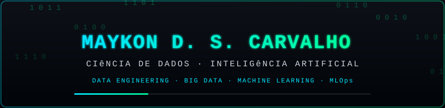

<!-- ===================== CABEÇALHO DE IMPACTO · PAINEL DIGITAL ===================== -->

<p align="center">
  
</p>

<h1 align="center">Maykon D. S. Carvalho</h1>

<p align="center">
  
</p>

<p align="center">
  <a href="https://www.linkedin.com/in/maykon-douglas-da-silva-carvalho-2aa271239/">
    
  </a>
  <a href="https://github.com/MDCarvalho-77">
    
  </a>
  
</p>

<p align="center">
  🎓 Estudante de Ciência de Dados e Inteligência Artificial — UniSENAI Florianópolis<br>
  💼 Profissional na Federação das Indústrias do Estado de Santa Catarina (FIESC)<br>
  📍 Florianópolis/SC
</p>

> **Da experiência em vendas à construção de soluções orientadas por dados — uma transição de carreira movida por aprendizado contínuo, tecnologia e problemas reais.**

<p align="center"></p>

## 🧭 Sobre mim

Minha trajetória profissional começou na área comercial e de vendas, onde desenvolvi uma visão prática de negócio: entender a necessidade real antes de propor qualquer solução. Hoje estou em transição de carreira para a tecnologia, construindo minha formação em Ciência de Dados e Inteligência Artificial na UniSENAI e atuando profissionalmente na FIESC.

Venho ampliando competências em dados, engenharia de dados, machine learning e MLOps por meio de projetos práticos. Esse percurso me dá um diferencial: trato cada problema a partir do negócio para só então desenhar a solução técnica — da análise do dado ao modelo em operação.

> **Experiência de negócio + formação em dados + construção de soluções tecnológicas.**

<p align="center"></p>

## 🔭 O que estou construindo

📊 **Data Science & Analytics**<br>
Análise, exploração e transformação de dados em informação útil.

⚙️ **Data Engineering & Big Data**<br>
Pipelines, processamento de dados, ETL e arquiteturas em camadas.

🤖 **AI & Machine Learning**<br>
Modelos preditivos e aplicações de inteligência artificial.

🔄 **MLOps**<br>
Monitoramento, reprodutibilidade e evolução de modelos em produção.

<p align="center"></p>

<!-- ===================== TECNOLOGIAS · DISPLAY POR CATEGORIAS ===================== -->

## 🧰 Tecnologias

<p align="center">
  
</p>

**`▚ Linguagens`**

<p>
  
  
  
  
</p>

**`▚ Engenharia de Dados & Big Data`**

<p>
  
  
  
  
</p>

**`▚ Bancos de dados`**

<p>
  
  
</p>

**`▚ Ciência de Dados & IA`**

<p>
  
  
  
  
  
</p>

**`▚ Dev · Versionamento · Infra`**

<p>
  
  
  
  
  
  
  
</p>

| Área | Tecnologias |
| --- | --- |
| **Data Science & Analytics** | Python · SQL · Pandas · Polars · NumPy |
| **Data Engineering** | ETL · Data Lake · PySpark |
| **Databases** | PostgreSQL · PL/pgSQL |
| **Big Data** | Apache Spark · PySpark |
| **Machine Learning / MLOps** | Machine Learning · MLOps · Data Drift |
| **Cloud & Automação** | PowerShell · Cloud Computing |
| **Development** | Docker · Git · GitHub · FastAPI · Streamlit · HTML |

> As tecnologias acima refletem as linguagens e ferramentas presentes nos meus repositórios públicos — de Python (dominante) a PowerShell e PL/pgSQL em projetos de Cloud Computing, além de Docker e HTML na geração de relatórios.

<p align="center"></p>

<!-- ===================== PROJETOS · TRILHA DE EVOLUÇÃO TÉCNICA ===================== -->

## 🚀 Projetos em destaque — trilha de evolução técnica

> Cada projeto marca uma etapa de aprendizado contínuo: dos fundamentos de Big Data e Data Lake até a observabilidade de dados em MLOps, passando por análise em escala e automação analítica colaborativa.

```text
 ▸ Etapa 01 ──▸ Etapa 02 ──▸ Etapa 03 ──▸ Etapa 04
 Fundamentos    Análise em    Automação      Observabilidade
 Big Data /     escala         analítica      de dados /
 Data Lake      (colaborativo) (colaborativo) MLOps
```

### ▸ Etapa 01 · Fundamentos de Big Data e Data Lake
[`Projeto-Final-Big-Data`](https://github.com/MDCarvalho-77/Projeto-Final-Big-Data)

Data Lake em **arquitetura medalhão (Bronze / Silver / Gold)** que transforma eventos de tracking de uma landing page em respostas de negócio — funil de compra, engajamento e receita. Os eventos brutos em JSON são refinados camada a camada com **Spark**, de uma cópia fiel do que chegou até tabelas prontas para análise.

Conceitos presentes no projeto: ingestão de eventos, processamento em camadas, Data Lake, qualidade de dados e documentação do pipeline.

### ▸ Etapa 02 · Análise de dados em escala (colaborativo)
[`radar-enem`](https://github.com/elipeBP/radar-enem)

Projeto colaborativo de processamento e análise de dados em escala, que cruza a nota do ENEM com a população brasileira (percentil e Z-Score) usando **Polars/DuckDB** para processar os microdados do INEP — vários GB que inviabilizam o processamento tradicional em memória. Atuei na **documentação** do projeto (relatórios e apresentações) e desenvolvi individualmente o **Filtro 04** como contribuição técnica ao trabalho do grupo.

### ▸ Etapa 03 · Automação analítica (colaborativo)
[`ist_ambiental_omics_automation`](https://github.com/elipeBP/ist_ambiental_omics_automation)

Projeto **colaborativo** de automação analítica aplicada a dados moleculares (pipeline de ETL para triagem molecular e enriquecimento de dados biológicos). Minha participação foi principalmente na **definição de regras de negócio, requisitos e documentação** — não na implementação do código.

### ▸ Etapa 04 · Observabilidade de dados e MLOps
[`Data-Drift`](https://github.com/MDCarvalho-77/Data-Drift)

Pipeline de **MLOps** para monitoramento de dados que detecta mudanças na distribuição (**data drift**) e problemas de qualidade de dados de forma automatizada e reprodutível. Aplica testes estatísticos adequados a cada tipo de variável (**KS-Test** para numéricas, **Qui-Quadrado** para categóricas), monitora valores ausentes e consolida tudo em um log de auditoria JSON e relatórios HTML gerados a partir dos números reais da execução.

Foco em observabilidade de dados e na recomendação de retreinamento — o projeto monitora, não treina o modelo.

<p align="center"></p>

<!-- ===================== ESTATÍSTICAS · INDICADORES DE TRAJETÓRIA ===================== -->

## 📊 GitHub em números

> Indicadores da minha trajetória no GitHub — construção de portfólio, atividade e aprendizado contínuo ao longo do tempo. Contexto, não protagonista.

<p align="center">
  
  
</p>

<p align="center">
  
</p>

<p align="center"></p>

## 📈 Evolução

Minha trajetória reflete uma transição profissional construída por etapas:

**Experiência de negócio** → **Dados & Analytics** → **Engenharia de Dados** → **Machine Learning** → **MLOps & IA**

<p align="center"></p>

## 🎯 O que busco

Estou em busca de oportunidades que me permitam seguir na transição para tecnologia, aplicando o conhecimento construído na formação, nos projetos práticos e na minha experiência profissional de negócio.

**Foco principal:** Data Science · Data Analytics · Engenharia de Dados

**Áreas de interesse e evolução:** Machine Learning · MLOps · Inteligência Artificial

Busco um ambiente onde eu possa contribuir com visão de negócio e continuar evoluindo tecnicamente.

<p align="center"></p>

## 📫 Conecte-se comigo

<p>
  <a href="https://www.linkedin.com/in/maykon-douglas-da-silva-carvalho-2aa271239/">
    
  </a>
  <a href="https://github.com/MDCarvalho-77">
    
  </a>
</p>

- **LinkedIn:** [maykon-douglas-da-silva-carvalho](https://www.linkedin.com/in/maykon-douglas-da-silva-carvalho-2aa271239/)
- **GitHub:** [MDCarvalho-77](https://github.com/MDCarvalho-77)

<p align="center"><i>⚡ Experiência de negócio + formação em dados + construção de soluções tecnológicas.</i></p>
